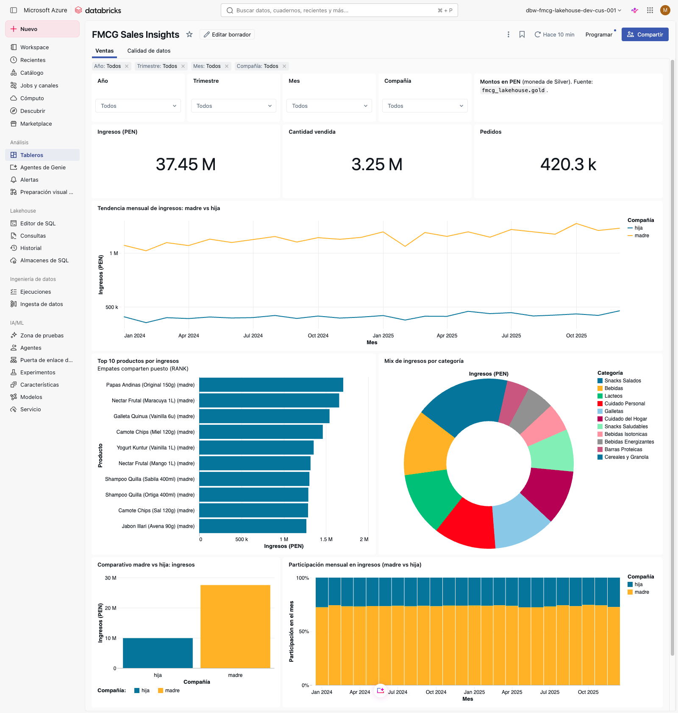
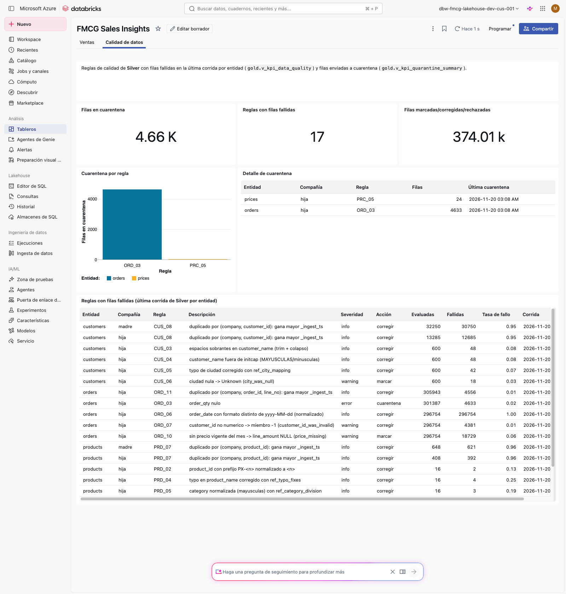
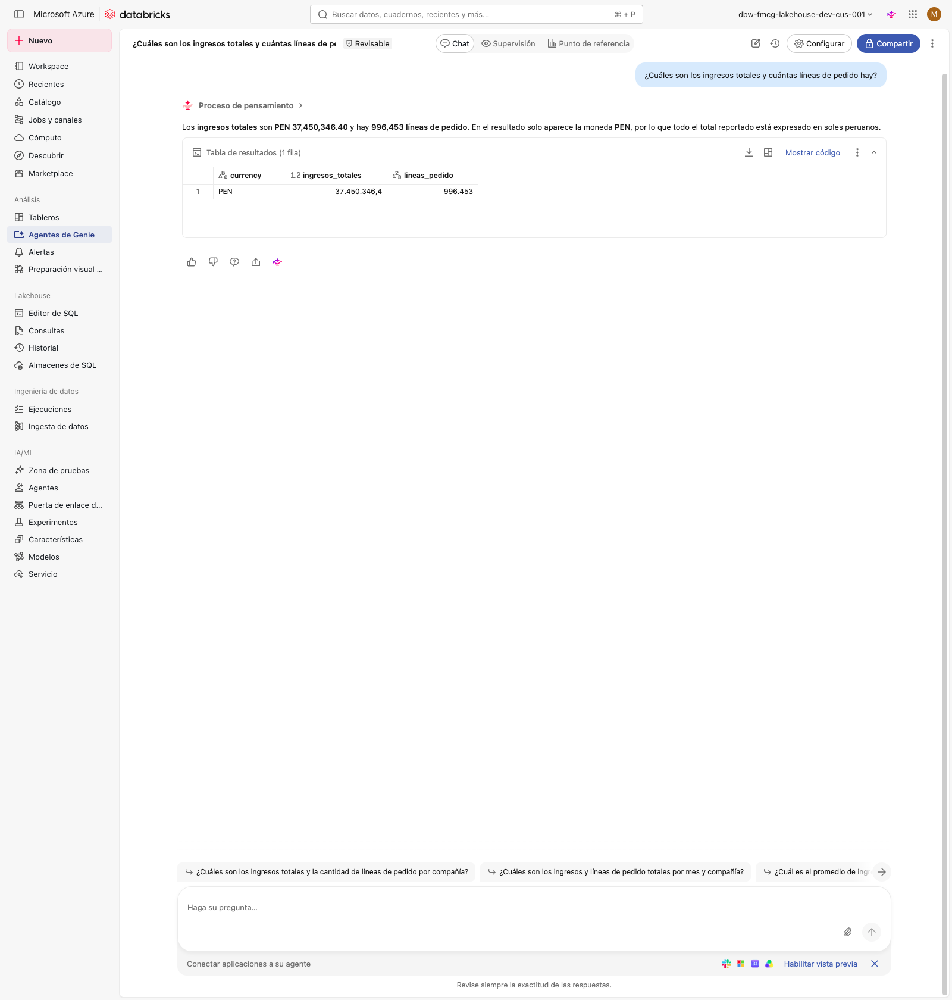
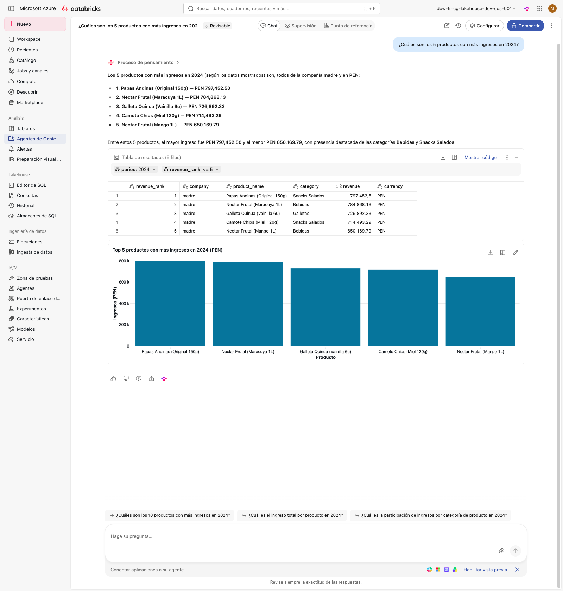
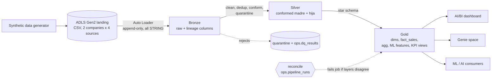

# FMCG Medallion Lakehouse on Azure Databricks

[](tests) [](#architecture) [](#architecture) [](databricks.yml) [](LICENSE)

An end-to-end **Bronze → Silver → Gold → BI/AI** lakehouse for a fast-moving consumer goods (FMCG) group, built on **ADLS Gen2, Azure Databricks (serverless) and Unity Catalog**. It consolidates two companies — a clean parent (*madre*) and a messy subsidiary (*hija*) — into one conformed star schema, with measurable data quality, reconciled layers, an incremental pipeline, an AI/BI dashboard and a Genie space.

> All data is **100 % synthetic** and generated reproducibly by [`src/datagen`](src/datagen). Reported amounts are in **PEN**.

Inspired by [`takadlag/databricks-medallion-lakehouse-fmcg`](https://github.com/takadlag/databricks-medallion-lakehouse-fmcg/tree/5e99b2b) (commit `5e99b2b`) and rebuilt from scratch: the original lacked source data, explicit parent tables, real quality checks, IaC and orchestration (see [`docs/00-analisis-referencia.md`](docs/00-analisis-referencia.md)).

## Results at a glance

| | |
|---|---|
| Source volume | 1,606 CSV files · ~1.0 M order lines |
| Bronze | 8/8 tables reconcile with the generator MANIFEST (rows and files), 0 rescued rows, idempotent re-runs |
| Silver | 33 documented quality rules · ~996 K clean lines · 4.6 K quarantined with reason |
| Gold | star schema + monthly aggregate + ML feature table + 6 KPI views |
| Revenue | 37,450,922.98 PEN identical in Silver, `fact_sales` and `agg_sales_monthly` |
| Independent check | KPIs recomputed in pure Python from the CSVs match Gold on every comparison ([`scripts/verify_gold_kpis.py`](scripts/verify_gold_kpis.py)) |
| Incremental | a real 25-row late batch moves only the affected months; a repeat run changes nothing |

## Screenshots

**AI/BI dashboard — Sales** (filters: year, quarter, month, company)



**AI/BI dashboard — Data quality** (failed rules and quarantine)



**Genie space** answering business questions over Gold, cross-checked against direct SQL




## Architecture



The editable diagram is in [`docs/arquitectura-databricks.drawio`](docs/arquitectura-databricks.drawio).

| Layer | What it does | Key design choices |
|---|---|---|
| **Landing** | Raw CSVs in an external UC volume | Date-partitioned; lifecycle policy documented |
| **Bronze** | Auto Loader ingestion, one task per source in parallel | Schema declared as STRING (no inference drift), append-only, lineage columns, pre-load validation, per-source registry |
| **Silver** | Typing, normalization, typo/city/category fixes, dedup (latest wins), conformed keys, price lookup, `line_amount` | 33 rule IDs with counts in `ops.dq_results`; bad rows go to `quarantine.*` with the rule that rejected them; incremental `MERGE` updates only strictly newer rows |
| **Gold** | `dim_date`, `dim_customer`, `dim_product`, `dim_price` (validity), `fact_sales`, `agg_sales_monthly`, `feature_sales_monthly` | Deterministic surrogate keys (`xxhash64`), `-1` unknown member, full idempotent rebuild, every table checked against its source and logged to `ops.gold_runs` |
| **Serving** | Dashboard (12 verified datasets, 2 pages) and Genie space (11 tables, instructions, sample SQL) | Reads only Gold; Genie answers contrasted with direct SQL |

Gold also answers what business teams asked of this layer: curated, aggregated tables that resolve a business question for BI **and** feature tables ready for ML/AI, so heavy transformations are not repeated downstream.

## Repository layout

```
infra/        Azure provisioning (az), Unity Catalog SQL, SQL runner, dashboard/Genie deployers
src/datagen/  reproducible synthetic data (+ incremental batch generator)
src/bronze/   Auto Loader ingestion, registry, validation
src/silver/   rules, transforms, DDL generator, expected counts
src/gold/     model, transforms, DDL generator
src/pipeline/ cross-layer reconciliation
resources/    Databricks jobs (bronze via databricks.yml, silver, gold, master pipeline)
dashboards/   AI/BI dashboard definition   genie/  Genie space definition
scripts/      independent KPI verification
tests/        164 pytest tests (pure logic, no Spark needed)
docs/         design, decisions, per-layer implementation, acceptance criteria
```

## Quick start

Prerequisites: Azure subscription, Azure CLI, Databricks CLI ≥ 0.288, Python 3.11+.

```bash
python -m venv .venv && .venv/bin/pip install -r requirements.txt
.venv/bin/pytest -q                                   # 164 tests, no cluster needed

# 1. Azure resources (RG, ADLS Gen2, Access Connector, premium workspace)
bash infra/01-provision-azure.sh                      # review variables first
# 2. Unity Catalog objects (the storage credential is created with the Databricks CLI; see the header of the SQL file)
export DATABRICKS_HOST=https://<your-workspace>.azuredatabricks.net DATABRICKS_AUTH_TYPE=azure-cli
python3 infra/run_sql.py infra/02-unity-catalog.sql --warehouse <warehouse-id>
python3 infra/run_sql.py infra/02b-seed-source-registry.sql --warehouse <warehouse-id>
# 3. Data
(cd src && python -m datagen --out ../data/generated)  # add --small for a quick run
bash infra/03-upload-landing.sh --dry-run             # then without --dry-run
# 4. Pipeline
export DATABRICKS_BUNDLE_ENGINE=direct
python3 infra/run_sql.py src/silver/sql/01_silver_ddl.sql --warehouse <warehouse-id>
export BUNDLE_VAR_warehouse_id=<warehouse-id>         # used by the dashboard resource
databricks bundle deploy -t dev
# medallion_pipeline chains bronze_ingest -> silver_transform -> gold_build -> reconcile
databricks bundle run medallion_pipeline -t dev --params mode=full   # later runs: mode=incremental
# 5. Serving
python3 infra/03-deploy-dashboard.py && python3 infra/04-deploy-genie.py
# 6. Independent verification
.venv/bin/python scripts/verify_gold_kpis.py
```

> `DATABRICKS_BUNDLE_ENGINE=direct` avoids the embedded Terraform download, which failed with an expired GPG key in CLI v0.288.

## Engineering notes

- **Validated where it runs.** There is no local Spark; two real serverless incompatibilities (`__file__` missing, `try_to_date` absent) only surfaced in the workspace and are documented with their root cause in [`docs/ESTADO.md`](docs/ESTADO.md).
- **Idempotent by construction.** Re-running Bronze, Silver, Gold or the master pipeline on unchanged input changes nothing.
- **Reconciliation gate.** The last task compares landing → bronze → silver → gold counts and amounts per company and source, and fails the job on any mismatch.
- **Per-layer write-ups.** Bronze [`docs/05`](docs/05-bronce-implementacion.md), Silver [`docs/08`](docs/08-silver-implementacion.md), Gold [`docs/09`](docs/09-gold-implementacion.md) and its [requirements](docs/09a-gold-requisitos.md), orchestration [`docs/10b`](docs/10b-incremental-y-orquestacion.md), serving [`docs/11`](docs/11-serving.md).
- **Honest status.** Verified vs assumed items are tracked in [`docs/ESTADO.md`](docs/ESTADO.md); decisions in [`docs/02-decisiones.md`](docs/02-decisiones.md); acceptance criteria and the scoring of this repo in [`docs/10-criterios-aceptacion.md`](docs/10-criterios-aceptacion.md).

## Known limitations and next steps

- Dimensions are SCD1; SCD2 is a documented open decision.
- Currency is fixed to PEN (a USD conversion layer is a future improvement).
- Some design proposals (D9–D25) await review by the advising data engineers.
- Dashboard filters are single-select parameters.
- Project documentation is written in Spanish.

## License

MIT — see [LICENSE](LICENSE).

---

# Resumen en español

Lakehouse medallion **Bronze → Silver → Gold → BI/IA** para un grupo de consumo masivo (empresa madre limpia + hija con datos sucios), sobre ADLS Gen2, Azure Databricks y Unity Catalog, con datos 100 % sintéticos, calidad medible, reconciliación entre capas, ingesta incremental, dashboard AI/BI y espacio Genie. La documentación completa (diseño, decisiones, criterios de aceptación) está en [`docs/`](docs) en español; empezá por [`docs/ESTADO.md`](docs/ESTADO.md).
